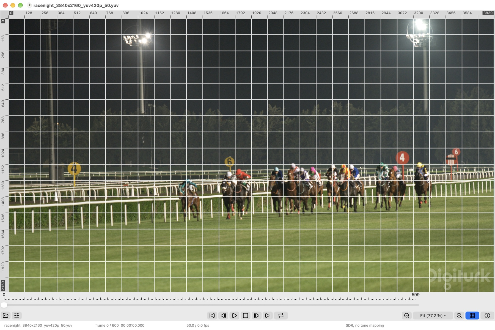
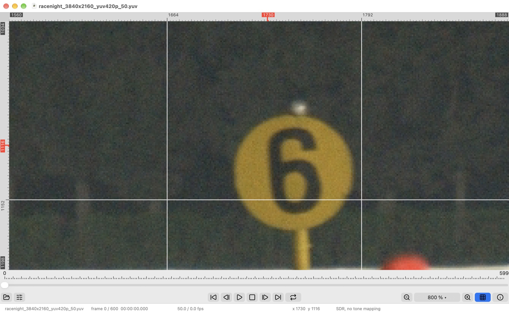
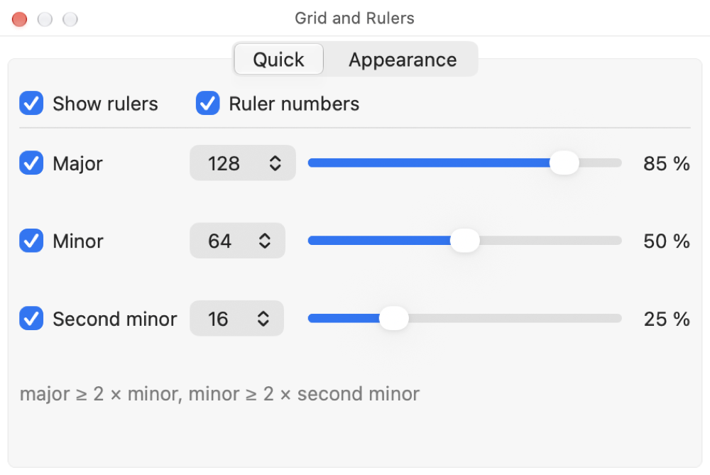
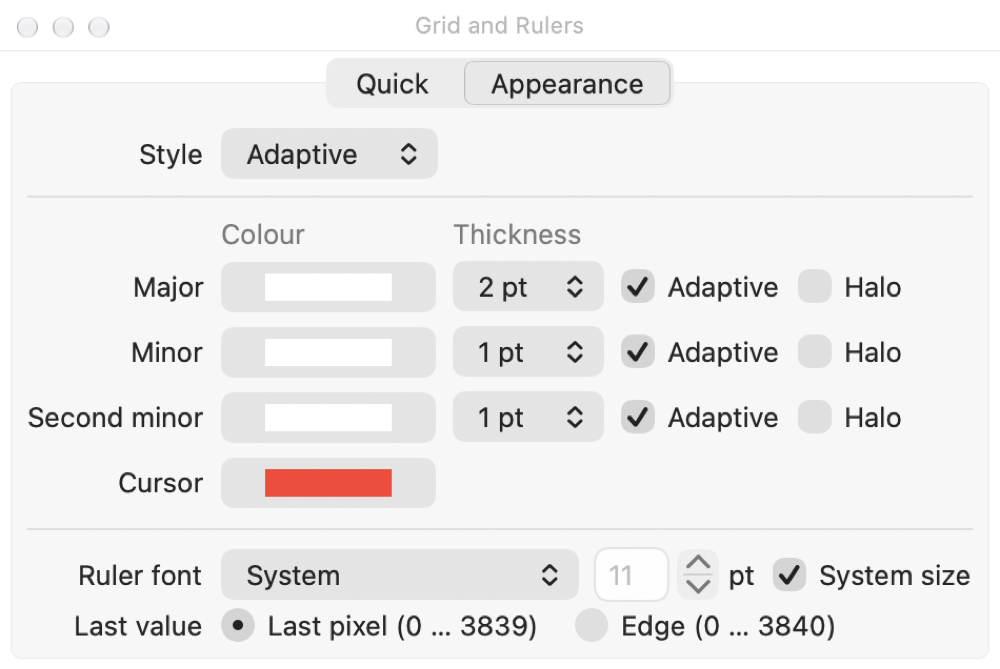
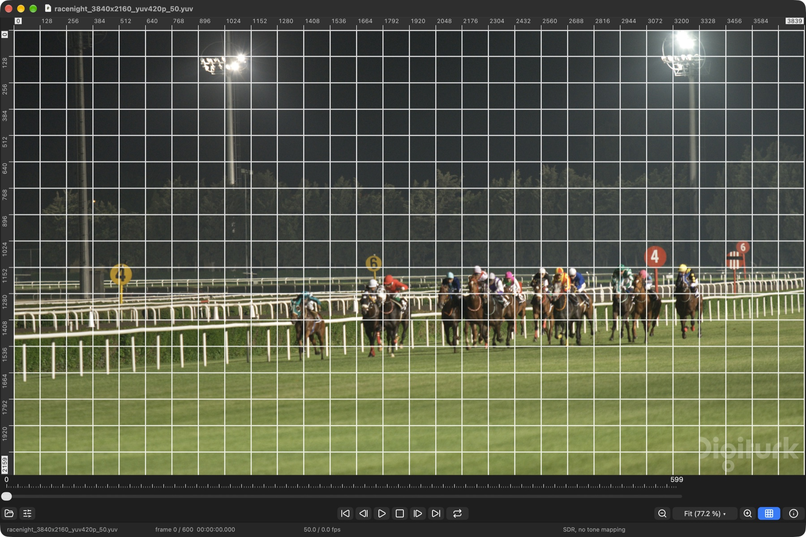

# rawreel 0.14.0

rawreel is a player for raw and lossless video on the GPU (Vulkan). Version 0.14.0 adds a grid
over the picture, rulers with image pixel numbers along its top and left edges, and the image
pixel under the pointer in the status bar. It plays the same sources as 0.13.0 and behaves the
same, except as listed below.

## New

- The grid draws lines over the picture at three levels, Major, Minor and Second minor, every 32,
  8 and 2 image pixels by default. The steps are 2 to 256, a power of two; major is at least
  twice minor, minor at least twice second minor. A level whose lines would be closer than its
  minimum spacing at the shown zoom is hidden; the minor levels are hidden with the major one.
- The rulers run along the top and left edges of the picture, not of the window, so they stay next
  to the picture when it is smaller than the window. Their ticks come from the same rule as the
  grid lines and land on the same pixels. The tick nearest the pointer is lit in the cursor colour
  (#ff3b30 by default), and a marker in that colour shows the pointer's position. A ruler shows no
  ticks when the major ticks are closer than the major level's minimum spacing. A press on a ruler
  does not pan the picture.
- Ruler numbers (on by default) show image pixel numbers in a line of 1.2 × the ruler font's size
  beside the ticks. The top ruler reads left to right, the left ruler bottom to top. A number sits
  on every major tick when the numbers fit there, else on every 2nd, 4th, 8th … major tick, so
  they stay round multiples (0, 128, 256 …); the ticks stay. Ruler numbers never turn a ruler off.
- End tags at the two ends of each ruler show the first and the last visible pixel at every zoom
  and pan, also while the ruler shows no ticks. When the ruler is too short for both tags only the
  first shows, and a number that would touch a tag is left out.
- With the pointer on the picture, a tag in the cursor colour shows its pixel, centred on it and
  kept inside the ruler; it hides the numbers and the end tag it touches. Its text is black on a
  cursor colour of relative luminance above 0.5, else white (white on the default red).
- The status bar shows the image pixel under the pointer, e.g. `x 812  y 403`; the field is empty
  off the picture and with no stream.
- G, View → Grid or the Grid button (right of Zoom in) shows and hides the grid; R or View →
  Rulers the rulers (on macOS: Show Grid / Hide Grid, Show Rulers / Hide Rulers). Both are off by
  default. The picture's context menu has the same two items and Grid and Rulers….
- View → Grid and Rulers… or a right-click on the Grid button (Ctrl-click on macOS) opens the Grid
  and Rulers window. Every change in it applies at once.
  - Quick: Show rulers, Ruler numbers, and per level its checkbox, step and opacity (0–100 %). A
    hidden level's row says why, e.g. "hidden at this zoom (2 px at 100 % = 1 pt, needs 3 pt)";
    while the rulers show no ticks a note says so, e.g. "Rulers off at this zoom: major ticks
    closer than 2 pt".
  - Appearance: Style (Plain, Adaptive, Coloured or Halo; Custom when the values match none), and
    per level its colour, thickness (1–4 pt), Adaptive (black lines on light pixels, white on
    dark) and Halo (a dark edge beside the line); then the cursor colour. A style sets the
    colours, opacities, Adaptive, Halo and the cursor colour.
  - Below them, outside the styles (a style never changes them): Ruler font, a family (System,
    then the OS's font families) and a size of 6–24 pt with System size (checked: the OS's small
    system font size, the default); a bigger ruler font makes the rulers thicker. Last value,
    Last pixel or Edge, each with its example from the open clip's width: with Edge the last end
    tag shows the edge after the last pixel ("0 … 3840" in place of "0 … 3839" on a 3840-wide
    clip). Both rows are disabled while the rulers or their numbers are off.
- The settings are saved in `rawreel.json` under `gui.grid` (per level `major`, `minor`,
  `secondMinor`: `show`, `step`, `opacity`, `colour`, `thickness`, `adaptive`, `halo`,
  `minimumSpacing`) and `gui.rulers` (`show`, `numbers`, `cursorColour`, `font.family`,
  `font.size`, `lastValue`). A wrong value in one of these keys gives that key's default with a
  warning, and the rest of the file is used; steps that break the step rule give 32 / 8 / 2. A
  `gui.grid`, level, `gui.rulers` or `gui.rulers.font` that is not an object gives its defaults
  and is not written over, unless it is `null`. `rawreel-cli` ignores these keys.

## Screenshots

A 3840 × 2160 clip at Fit on macOS, with a major grid every 128 pixels: the numbers sit on every
major tick, and the end tags show the whole picture, 0 … 3839 and 0 … 2159.

The same clip at 800 %: the end tags show the visible part (1560 … 1888, 1034 … 1198), and the
cursor tags and lit ticks show the pixel under the pointer, also in the status bar.

The Grid and Rulers window, Quick and Appearance tabs:

The dark appearance:

The clip is RaceNight © Digiturk, used under Creative Commons Attribution-NonCommercial 3.0
(https://creativecommons.org/licenses/by-nc/3.0/).

## Changes

- Build: dvv-build 0.6.0, dvv-base 0.6.0, dvv-registry 0.3.0, dvv-platform 0.4.0, dvv-gpu 0.6.0,
  dvv-media 0.5.0 and dvv-components 0.6.0.

## Requirements

Windows: Windows 10 or newer, 64-bit, with a GPU driver that supports Vulkan 1.4, and the
Microsoft Visual C++ Redistributable (x64) 14.52 or newer, which the zip does not include.
"MSVCP140.dll was not found" at the start means it is missing or too old.

Linux: Ubuntu 24.04 (x86-64) with its current updates (glibc 2.39); an X11 desktop, or a Wayland
desktop with XWayland; GTK 3; the Vulkan loader `libvulkan1`; and a Vulkan 1.4 driver (Mesa from
`noble-updates` or the GPU vendor's driver). Install the system packages with
`sudo apt install libgtk-3-0t64 libsm6 libice6 libvulkan1 mesa-vulkan-drivers`.

macOS: a Mac with Apple Silicon and macOS 27 or newer. The app brings its Vulkan loader, its
Vulkan driver and FFmpeg; nothing else is needed. Intel Macs are not supported.
