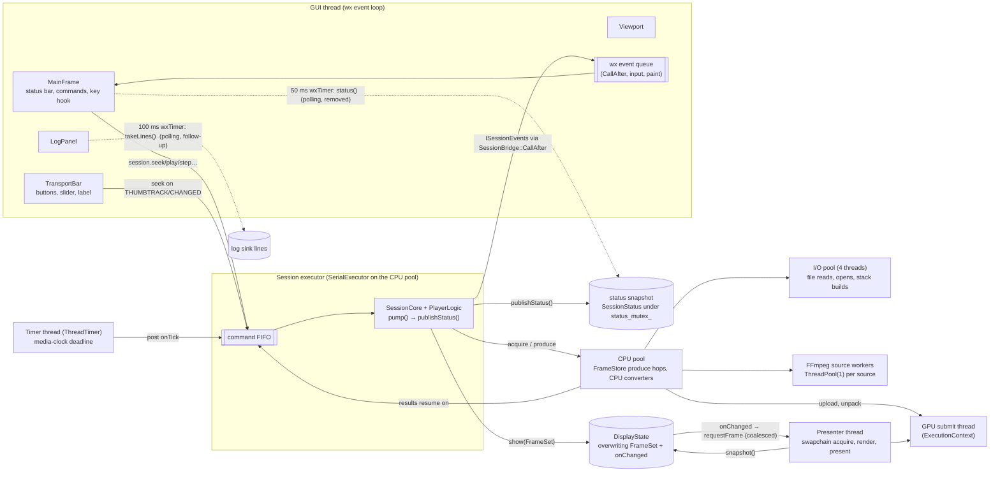
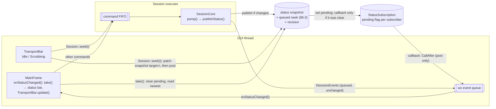
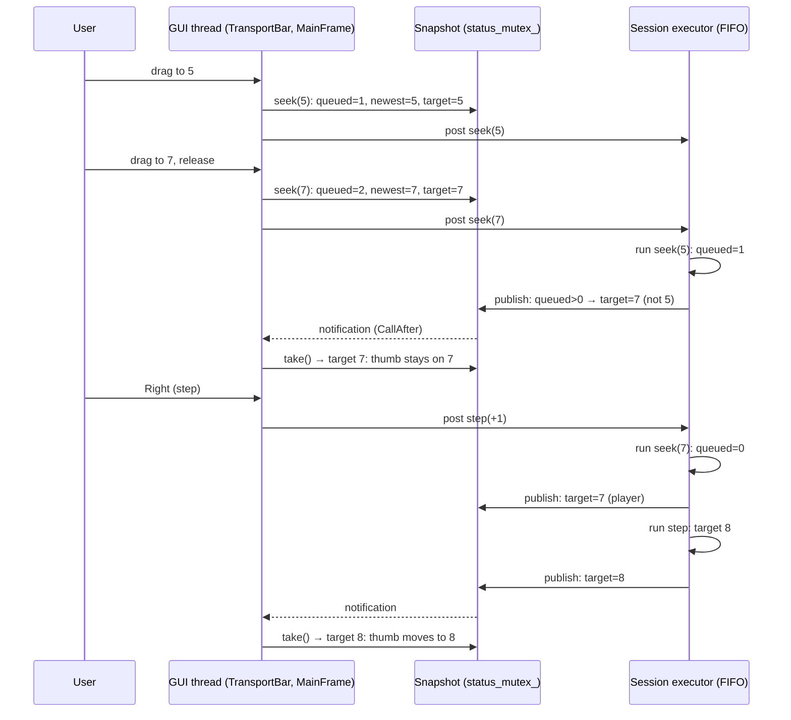

# Session state notifications: design

Status: implemented (Tasks 1-8 of the plan); the notification rate is measured (§9a Results); the
manual scenarios of §9a are for the user to run. Revision 2 (second plan review's fixes: §6.3
notification of patches, target chosen under the lock, refused seeks; §6.6 slider details).
Date 2026-11-08. Revision 2 replaces the GUI-side stale-snapshot filter of revision 1 with a `target`
that already includes the requests the Session has accepted (U-EV6), after the plan reviews showed
the filter cannot be exact (§10). Inputs: rawreel `main` at 280fc73, the rawreel spec
(`2026-10-19-rawreel-design.md`, §4.3, §10.2, D10, D20) and the M3 plan
(`docs/superpowers/plans/2026-10-23-m3-player.md`, Tasks 5, 6, 9 and 10). This is the
prerequisite of the video control panel spec (the transport panel redesign), which is revised on
top of it.

## 1. Intent

The GUI learns the player's state by **polling**: a 50 ms `wxTimer` in `MainFrame`
(`STATUS_TICK_MS`, `src/gui/main_frame.cpp:56`) reads `Session::status()` 20 times a second and
pushes it into the status bar and the transport bar. A second timing rule sits on top of it: the
transport bar ignores the polled position for 250 ms after any slider scroll event (`SCROLL_HOLD`,
`src/gui/transport_bar.cpp:18`), because the polled `position` is the last **shown** frame and a
seek takes time (up to 122.5 ms measured on the M3.1 4K60 run) to show its frame.

The user's verdict: polling is bad design, and the time window on top of it is worse. Both are
replaced by **notifications**: the Session tells its consumers that its state changed, and each
consumer reacts. Nothing in the GUI runs on a clock to find out what the player is doing, no time
window guesses who owns the slider, and the GUI never needs a confirmation of its own requests.

The reason polling was chosen is real and must stay solved: the Session runs on its own executor
at the video rate, the GUI thread is sometimes held back (presenter teardown, menu tracking,
Windows move and resize loops), and neither may wait for the other. A queue of every state change
would grow while the GUI is held back and replay outdated states afterwards. The design keeps that
property with an **overwriting** notification: one pending notification per consumer at most,
carrying no data; the consumer reads the newest snapshot when it handles it.

## 2. Decisions made by the user

- **U-EV1** Polling is replaced by events; the GUI does not poll the Session's state on a timer.
- **U-EV2** Two delivery kinds: a **queue**, where every event is delivered, and an **overwriting**
  event, where the producer overwrites its pending event so the consumer always gets one event, not
  a continuous stream.
- **U-EV3** Other parts may **register** to receive state changes (more than one receiver).
- **U-EV4** This redesign is its own design doc and comes first; the control panel spec is revised
  on top of it.
- **U-EV5** No flicker after a drag (7 → 5 → 7 must stay on 7).
- **U-EV6** No acknowledgement, echo or confirmation of the GUI's requests: no sequence number, no
  counter of processed requests, no timestamp sent and returned. The ordering knowledge stays in
  the Session, which owns the queue: a request is part of the published state from the moment the
  Session accepts it (§6.3).

## 3. Goals, non-goals, anti-goals

Goals:

- G1. The status bar and the transport bar update when the Session's state changes, and only then:
  an idle, paused player causes no GUI work at all.
- G2. A Play/Pause, Loop, step or seek command shows in the GUI within one GUI event-loop turn of
  the Session publishing it, instead of up to 50 ms later.
- G3. The slider never jumps back during or after a drag, however long a seek takes, however long
  the user holds the thumb still, and whatever key the user presses right after releasing it. No
  time constant decides this.
- G4. Several consumers can subscribe to state changes independently and unsubscribe safely.
- G5. A held-back or slow consumer costs the Session nothing and never sees a backlog: after it
  wakes it handles at most one state notification and reads the newest state.

Non-goals:

- The new control panel (ticks, labels, icons, scrub marker): the panel spec.
- New discrete events. The four existing ones (`streamsChanged`, `formatNeeded`, `stackChanged`,
  `error`) already form the queue kind and stay as they are (§6.5).
- The selftest runner's own 50 ms step timer (`src/gui/selftest.cpp:78`, `TICK_MS`), a test driver;
  its "GUI kept ticking" check (R10) measures that timer and is unaffected.
- The Log pane's 100 ms `wxTimer` (`src/gui/log_panel.cpp:13`), which drains the log sink's lines.
  It is polling too, of a different producer; it is a follow-up with the same pattern (an
  overwriting notification from the log sink), not part of this change.
- Changing what the status bar shows or how `actualFps` and the bottleneck are computed (§9, frozen
  `actualFps`).
- The Session's internal scheduling (`ITimer`, the media clock, `pump()`): the player is timed by
  the video, which is not polling.

Anti-goals (a failure even if it works):

- A notification queue that grows while the GUI is held back, or a consumer that replays old
  positions after waking.
- A replacement timer under another name: a `CallLater`, idle-event loop or "check again in N ms"
  in the GUI to discover state.
- A confirmation channel in any form (U-EV6).
- A Session that knows about wx, the GUI thread or `CallAfter` (it stays wx-free, D10).
- Callbacks that run consumer code on the Session executor beyond posting.

## 4. Constraints carried over from the project

- The Session is a wx-free actor; every command posts to its `SerialExecutor`; events are called on
  that executor and must not block (`src/core/session_types.h:61`, D10). Event payloads carry values
  and `weak_ptr`s only, never strong references to managed objects (D10).
- Observers are held by ids or `weak_ptr` (rawreel spec §9.4).
- C++23, the project's warnings-as-errors and clang-tidy profile; TSan and ASan CI jobs run the
  core tests, so the new synchronisation must be clean under TSan.
- One squashed commit per PR; the user merges.

## 5. Architecture today: threads, queues, events and data

### 5.1 Threads and queues



### 5.2 The three channels out of the Session

| Channel | Producer → consumer | Delivery | Kind |
|---|---|---|---|
| Frames | Session executor → `DisplayState` → presenter thread | Overwriting mailbox (newest `FrameSet` wins, "overwritten" counted) + coalesced `requestFrame` | Push, overwrite |
| Discrete events | Session executor → `SessionBridge` → GUI (`CallAfter`) | Queued, every event, in order | Push, queue |
| State (`SessionStatus`) | Session executor → snapshot → **GUI timer reads every 50 ms** | Overwriting snapshot, read by polling | **Poll** (replaced here) |

### 5.3 Findings in the code

- `SessionCore::publishStatus()` (`src/core/session.cpp:697`) builds a full `SessionStatus` and
  stores it under `status_mutex_` at the end of every `pump()` (line 283). `pump()` runs after
  every command (`Session::command`, line 1072), every media-clock tick (`onTick`, line 254) and
  every request or open completion; `publishStatus()` also runs during shutdown and device loss
  (lines 367, 381, 459). The snapshot is therefore already **pushed** at every change; only the
  reader polls it.
- Readers of `status()`: the 50 ms `MainFrame::onStatusTimer` (`main_frame.cpp:856`), the only
  periodic reader and the only one replaced; on-demand reads in `MainFrame` (`hasStream()` line
  339, `isAvailable(Command::Last)` line 363, `Command::Last` line 419, the Format dialog's kept
  position line 541), which stay; tests (`SessionFixture::waitStatus` polls every millisecond,
  `tests/session_fixture.cpp:365`; direct reads in the session tests); the GUI selftests.
- `PlayerStatus::position` is "the last shown index" (`src/core/player.h:28`).
  `PlayerLogic::target()` is "the pending seek, step, start or stall index, else the position"
  (`player.h:58-60`); it is not in the snapshot.
- **The root of the slider problem:** `target` exists only once the executor has **run** a
  command. A seek the GUI has called but the executor has not run yet sits in the command FIFO, and
  every snapshot published meanwhile (for example by the previous seek) describes the past. Any
  GUI-side fix has to reconstruct the Session's queue from outside, which needs a confirmation.
- `actualFps` is a rate over the last second of playback shows, computed at publish time
  (`player.cpp:322`).
- The overwriting pattern already exists for frames: `DisplayState::show()` replaces the pending
  `FrameSet` and calls one registered callback; `setOnChanged({})` guarantees that no callback is
  running and none will run (`src/render/display_state.h:30-39`).
- `ISessionEvents` has one implementation, `SessionBridge`, which forwards each event with
  `CallAfter` and is detached before the frame dies (`src/gui/session_bridge.h`).

## 6. How it works (decided parts)

### 6.1 Architecture after the change



The frame channel and the discrete events are unchanged. The state channel becomes push +
overwrite, like the frame channel.

### 6.2 State subscriptions (new Session API)

- `Session::subscribeStatus(callback)` registers a subscriber and returns a `StatusSubscription`
  (a move-only RAII token). Any number of subscriptions may exist at once (U-EV3).
- Each subscription has one **pending** flag. When the Session publishes a snapshot that differs
  from the previous one, it sets the flag of every subscription; for each subscription whose flag
  was clear before, it calls that subscription's callback once. While the flag is set, further
  publishes call nothing for that subscription (the overwrite, U-EV2).
- The callback runs on the Session executor, carries no data and must not block: the GUI's
  callback only posts (`CallAfter`). It is called with no Session lock held other than the
  subscription's own callback mutex, so a callback that calls `take()` cannot deadlock.
- `StatusSubscription::take()` clears the flag **and then** returns the newest snapshot. Clearing
  before reading means no change is lost: a publish that lands after the read sets the flag again
  and calls the callback again. `take()` on an empty or moved-from token, or after the Session is
  gone, returns a default `SessionStatus`.
- Destroying the token unsubscribes. Binding, as for `DisplayState::setOnChanged({})`: once the
  destructor returns, no callback of that subscription is running and none will run. It must not
  be called from inside its own callback. The token holds no strong reference to the Session's
  core; a token that outlives the Session unsubscribes as a no-op.
- `Session::status()` stays, unchanged, for on-demand queries (§5.3).

### 6.3 What the snapshot gains: a target that includes accepted requests (U-EV6)

- `PlayerStatus::target`: the frame the player is going to. `position` keeps its meaning, the frame
  on screen.
- **Read-your-writes.** `Session::seek(index)` does this on the caller's thread, all under the
  snapshot's mutex: it posts the seek command first (so a throwing post leaves nothing behind;
  `SerialExecutor::post` never runs the task inline, so posting under the lock cannot deadlock),
  then, if the stored snapshot has a stream with a bounded length above zero, it records the request
  as the newest **queued seek** (the index clamped to `[0, length − 1]` with the snapshot's
  length), increments the count of queued seeks, patches the stored snapshot's `target` to that
  index and increments `revision`. Without a stream or with an unbounded length (the slider is
  disabled) nothing is patched or counted. Because both happen under one lock, the order of the
  patches is the order of the commands in the FIFO.
- The seek command decrements the queued count (when its call counted itself) **before** the
  Session's "stopping" check, so a seek refused during shutdown still decrements; then it calls the
  player.
- `publishStatus()` chooses `target` **inside** the same locked section that compares and stores
  the snapshot (never while building it outside the lock, or a seek patched in between would be
  overwritten by an older target): the newest queued seek while the queued count is above zero and
  a player exists and the Session is not stopping, else the snapshot's player target
  (`PlayerLogic::target()`, -1 without a player).
- **A patch is always notified.** The Session keeps the revision of its last fan-out
  (`notified_revision_`, under the same mutex). A publish fans out when it stored a change **or**
  when the stored revision differs from `notified_revision_` (a patch happened since the last
  fan-out). Without this, a seek whose executor-side snapshot equals the patched one (the frame is
  already requested and nothing else changed) would never reach a second subscriber, nor the GUI
  for a seek it did not make itself (Home/End through `MainFrame::execute`).
- Consequence: no snapshot the GUI can read after `seek(7)` returned says anything older than 7.
  Every command the GUI sends later (a step, Play, Home) runs after the queued seeks, so its effect
  appears in order: snapshots say 7 until the step runs, then its result. The GUI needs no filter,
  no confirmation and no count of its own (§10 explains why a GUI-side filter could not be exact).
- The call-time patch does not call subscribers itself (it runs on the caller's thread); the
  executor's next publish fans it out (the rule above), as soon as it runs the seek.
- `SessionStatus::revision`: a counter incremented on every published change, by the executor's
  publish or by a seek's patch (starts at 1 with the first publish, never goes back). It lets tests
  and consumers tell snapshots apart; it is not sent back to anyone and orders nothing.
- "Differs from the previous one" (§6.2) is a field-by-field comparison of `SessionStatus`
  excluding `revision` (`operator==`).

### 6.4 Sequence: a fast drag and a key press



### 6.5 Discrete events stay a single listener

`ISessionEvents` keeps exactly one listener (`SessionOptions::events`). `formatNeeded` opens a
modal dialog and `error` shows the infobar: these need one owner. (Claude's call, C3.)

### 6.6 The GUI

- `MainFrame` drops `status_timer_`, `STATUS_TICK_MS` and `onStatusTimer`. It owns one
  `StatusSubscription`, created once the Session exists (the timer was started in
  `buildStatusBar()`, `main_frame.cpp:322`, which runs in the frame constructor before `App`
  creates the Session) and destroyed where the timer is stopped today (`main_frame.cpp:956` and the
  destructor, line 259), before the frame dies, like `SessionBridge::detach`.
- Its callback posts `onStatusChanged()` to the frame with `CallAfter`. `onStatusChanged()` calls
  `take()` and does what `onStatusTimer` did: `transportBar().update(...)` and the status bar
  fields, setting text only when it changed. It returns at once when the token is empty or the frame
  is closing, so a notification that runs after the token is gone changes nothing. Subscribing posts
  one `onStatusChanged()` itself, so the first snapshot (published before the subscription
  existed) is shown.
- The transport bar drops `SCROLL_HOLD`, `last_scroll_` and the time comparison. It has two states:
  - `Idle` → `Scrubbing` on a `wxEVT_SCROLL_THUMBTRACK` while the slider is enabled.
  - `Scrubbing` → `Idle` on `wxEVT_SCROLL_THUMBRELEASE` or `wxEVT_SCROLL_CHANGED`, and, as an
    event-driven backstop, in `update()` when the left mouse button is no longer down (read through
    a test seam, C7). The backstop covers input that ends without a release event (macOS never
    sends `CHANGED`, and keyboard input on a focused macOS slider sends `THUMBTRACK` with no
    release) and runs only when a notification arrives, never on a timer. A `THUMBRELEASE` in
    `Idle` does nothing.
  - While `Scrubbing`, `update()` never sets the slider's value, so it never disturbs the native
    drag. While `Idle`, the slider shows `target`.
  - Seeking stays live: every `THUMBTRACK` and every `CHANGED` calls `seek()` with the slider's
    value, unless it equals the last value this bar sent during the current interaction (no
    duplicate seeks); `update()` in `Idle` forgets that value, so a later drag back to the same
    frame after another command moved the player does seek. `CHANGED` without a drag (a Windows
    track click sends `PAGEUP/PAGEDOWN` then `CHANGED`; the wheel and keys send `CHANGED` on Windows
    and GTK; a GTK track click sends `THUMBTRACK`, `THUMBRELEASE`, `CHANGED`) seeks and leaves the bar
    `Idle`; the read-your-writes `target` keeps the thumb where it went. This keeps today's
    behaviour and the `rawreel.gui_selftest.player` step "slider to 5" (`selftest.cpp:1650`).
  - Scroll events while the slider is disabled (no stream, unbounded length) are ignored: no seek,
    no state change.
  - A change of the stream (the slider's range changes, or no stream) puts the bar in `Idle` and
    forgets the last sent value before anything else.
- The frame label and the status bar keep showing `position`, the frame on screen.

### 6.7 Tests

- Core: `SessionFixture::waitStatus` waits on a subscription (a condition variable signalled by the
  callback, with the wake flag set under the mutex) instead of polling every millisecond.
- New core tests for §6.2: one callback per burst until `take()`; a publish after `take()` calls
  again; no callback for an unchanged snapshot; several independent subscribers; destroying a token
  while publishes run (no callback after the destructor returns, TSan-clean); a token that outlives
  the Session; `take()` on an empty token.
- New core tests for §6.3, with the executor held inside a subscriber's callback so the seeks are
  really queued: after `seek(5)` and `seek(7)`, every snapshot says 7 before and after the executor
  runs seek(5); a step posted after a queued seek appears after it; the call-time clamp; no patch
  without a stream; a patched seek whose executor snapshot equals the patch is still notified; a
  seek refused during shutdown leaves no queued target; `target` before and after the frame is
  shown; `revision` only on change.
- GUI selftest: the existing player steps keep passing unchanged. New steps: idle costs nothing; a
  held drag on a slow source (the slider never shows another value than the last one dragged to,
  sampled on every `update()`, and does not move while held); a stream change during a scrub resets
  the bar; a disabled slider does not scrub; closing during a slow seek shuts down cleanly.

## 7. Calls made by Claude (not agreed by the user; review these)

- **C1 Notify only on change.** A publish that leaves the snapshot equal calls no callback.
- **C2 No new discrete events.** Play/pause, loop, seek and length changes are state; a burst
  collapses into the final state, which is what a display needs.
- **C3 Discrete events keep one listener** (§6.5).
- **C4 The slider follows `target`.** The frame label and status bar keep `position`. Showing both
  while a seek is pending is left to the panel spec.
- **C5 `revision` in the snapshot**, for tests and de-duplication only.
- **C6 Tests' `waitStatus` moves to the subscription**, so the new API has a real core consumer.
- **C7 The mouse-button backstop reads the button through a seam**: `TransportBar` takes a
  `leftButtonDown` function, `wxGetMouseState().LeftIsDown()` by default; the selftest replaces it
  so it can hold a drag in CI.
- **C8 The rate fallback is a per-subscription filter** (§9), so tests are never starved.
- **C9 A failed seek lets the slider go back.** When the target frame fails, the player drops the
  pending index and `target` falls back to the shown position; the slider showing the frame on
  screen is intended (the `error` event explains it).
- **C10 Only `seek` is read-your-writes.** It is the only command whose resulting `target` the
  caller knows (the index it passed). Steps, Play, Stop and Home/End go through the FIFO as before;
  their effects appear in order after any queued seek. (Home and End are seeks already, `Command::
  First`/`Last` → `seek(0)`/`seek(length − 1)`, so they are read-your-writes too.)
- **C11 `--debug-seek-delay MS`**, a rawreel-gui developer option that delays every frame produce
  by `MS` ms (a wrapper around the sources the Session opens; no dvv-components change). The wait
  ends early when the app shuts down (woken as the first step of `App::shutdownSession()`), so
  Ctrl+Q during a slow seek does not hang. With the delay at 0 the wrapper forwards directly, with
  no thread hop, so the perf selftest is unchanged.
- **C12 `--debug-transport`**, a rawreel-gui developer option that logs every handled
  notification and every scrub state change at Info level (rawreel has no log-level setting). Off
  by default; it costs nothing when off.

## 8. Done means

- No `wxTimer` or `CallLater` in `src/gui` exists to read the Session's state; `STATUS_TICK_MS`,
  `onStatusTimer`, `SCROLL_HOLD` and `last_scroll_` are gone. (The Log pane's timer remains, §3.)
- With a stream open and paused, the GUI thread does no status work until a command or event
  changes the state.
- After a seek on a slow source (`--debug-seek-delay` of at least 500 ms), the slider stays at the
  target until the frame shows; after holding the thumb still for 2 s mid-drag, it has not moved;
  after a drag through several values and a release, it never shows a value other than the last one
  dragged to until the next command moves the player.
- The core tests of §6.7 pass on every CI job, TSan and ASan included; the existing GUI selftests
  pass unchanged, plus the new steps.
- The rawreel spec's text on "status polled every 50 ms" and the M3 plan's `SCROLL_HOLD`
  description carry a note pointing here.

## 9. Risks and notes

- **Notification rate during playback.** `pump()` runs on every tick and every request completion,
  so at 60 fps with prefetch the Session may publish several hundred changed snapshots a second
  (`inflight` and `readyAhead` change with each request). The overwrite bounds GUI work to one
  handler per GUI turn. The builder measures the handler rate during 4K60 playback. It is "a
  problem" when `onStatusChanged()` runs more than 120 times a second on average over 10 s of
  playback. The remedy then is a per-subscription option: `subscribeStatus` takes a filter, `All`
  (the default) or `Visible` (changes to `inflight` and `readyAhead` alone do not set the pending
  flag). The GUI uses `Visible`; tests keep `All`, so `settle()` (which waits on exactly those
  fields, `tests/session_fixture.cpp:385`) is unaffected. Below the threshold the filter is not
  built.
- **Frozen `actualFps` (existing behaviour).** After a pause the last snapshot keeps the one-second
  show count, so the status bar may show the playing rate while paused. Unchanged here.
- **Call-time clamp vs. a stream change.** A seek called while an open is still queued is clamped
  with the old stream's length; the executor clamps again with the new one, so at worst the thumb
  corrects once to the new stream's range. The range change resets the bar anyway (§6.6).
- **Callback contract.** A subscriber that does real work in the callback would stall the Session
  executor. The contract says "post only"; the GUI is the only production subscriber. (The core
  test of §6.7 holds the executor in a callback on purpose, to queue seeks deterministically.)

## 9a. Manual check: see it working

A hands-on walk through the corner cases. The queued-seek window lasts well under a millisecond on
a fast machine and cannot be seen by eye; `--debug-seek-delay` makes the frame loads slow, and
`--debug-transport` prints what the GUI receives.

### Setup

- `--debug-seek-delay MS`: every frame produce in this run waits `MS` milliseconds first.
- `--debug-transport`: one log line per state notification the GUI handles (`transport:
  notification revision R position P target T playing 0|1`) and per scrub state change
  (`transport: scrub Idle -> Scrubbing`). The lines appear in the Log pane and in `rawreel.log`.

Start the app from the build's binary folder (`$bin` in the README; on macOS the binary is
`$bin/rawreel-gui.app/Contents/MacOS/rawreel-gui`), with the Log pane visible:

```sh
rawreel-gui --debug-transport --debug-seek-delay 800 \
  'synthetic:gradient?fmt=yuv420p10le&size=1920x1080&frames=2000'
```

(On Windows: `.\rawreel-gui.exe` and the same arguments, the URI in single quotes.)

### Scenarios

1. **Idle costs nothing.** Wait until frame 0 shows and the player is paused. Watch the Log pane
   for 10 s.
   - Expect: no notification lines while nothing happens.
   - Failure: lines keep appearing at a steady rate.
2. **Commands show at once.** Press Space, wait 2 s, press Space again; press L twice.
   - Expect: the Play/Pause button and the Loop toggle change on the key press.
   - Failure: a visible lag, or a burst of lines with the same values.
3. **The slider waits for a slow seek.** Paused, click on the slider track far from the thumb.
   - Expect: the thumb moves to the click and stays; the picture and the frame label change about
     0.8 s later. The log shows `target` at the new value at once and `position` 0.8 s later.
   - Failure: the thumb jumps back to the old frame and forward again.
4. **Hold still mid-drag.** Drag to about frame 600, keep the button pressed for 5 s, release.
   - Expect: the thumb stays under the pointer; the picture catches up; nothing moves on release.
   - Failure: the thumb drifts back while held, or jumps on release.
5. **A fast drag and release (7 → 5 → 7).** Drag quickly from 0 to about 1000 and release at once.
   - Expect: the thumb stays where you released it. Every notification line after the release
     shows `target` equal to the release value.
   - Failure: a line after the release with an earlier `target`, or a visible flick back.
6. **Back and forth.** Drag 0 → 1000 → 300 → 1000 and release.
   - Expect: no visible jump; every line after the release shows `target` 1000.
7. **A key right after the release.** Drag fast, release, press Right at once.
   - Expect: the slider ends on the release frame plus one; lines after the release show the
     release value, then the stepped value, never an earlier one.
8. **Release outside the window.** Drag, move the pointer off the window (or switch apps while
   dragging), release outside, then press Space.
   - Expect: the scrub ends (`scrub Scrubbing -> Idle` on the next notification) and the thumb
     follows playback.
   - Failure: the thumb stays put while the frame label advances.
9. **A held-back GUI does not replay old states.** Restart without the delay, play, then hold the
   GUI back for 5 s: on Windows, press and hold on the title bar without moving; on macOS and
   Windows, keep a menu of the menu bar open. (A modal dialog does not count: wx keeps handling
   posted events in it.)
   - Expect: either updates continue, or one notification line with the current position on
     release, then normal updates.
   - Failure: a run of lines with old positions replayed one after another.
10. **Playback rate.** Without the delay, play a 60 fps clip for 10 s
    (`synthetic:gradient?fmt=yuv420p10le&size=3840x2160&frames=600&fps=60`) and count the
    notification lines per second in `rawreel.log`.
    - Expect: at most about 120 a second; above that the §9 filter (C8) is needed.
11. **Close during a seek.** With the delay at 3000, click far on the slider and press Ctrl+Q (Cmd+Q
    on macOS) before the frame shows.
    - Expect: the app closes within a second, no crash or hang, no notification line after the
      shutdown lines in `rawreel.log`.

Run scenarios 3–8 on each platform you can reach: macOS and GTK differ in the release events
(§6.6).

### Results

**Notification rate (scenario 10, §9).** Measured with the `perf` selftest, which plays 600 frames
unattended, on a Release build and the source
`synthetic:gradient?fmt=yuv420p10le&size=3840x2160&frames=600&fps=60`, with `--debug-transport`.
The handler counts every entry of `onStatusChanged()` per steady-clock second (before the
revision check). The per-notification log lines were printing during the run, so their cost is
part of the measurement.

- Machine: Apple Silicon Mac, macOS 27.0.1 (build 26A434).
- Achieved rate: `actualFps` 38.6 against the target 60 (the report shows 186 stalls and the
  bottleneck "disk"); this Mac does not sustain the synthetic 4K source at 60 fps, so playback
  ran slower than a real 4K60 clip would.
- Playback seconds (15 values): 38 (partial first second), 74, 59, 63, 68, 63, 71, 55, 75, 82, 63,
  76, 59, 62, 95. Average 66.9 a second (68.9 without the partial first second), maximum 95.
- Seek phase (20 random seeks, 1.5 s, mixed with the end of playback): 83 and 49 for the two
  seconds that completed.
- Result: the average is below the threshold of 120 a second, so the `Visible` filter (C8, Task
  8a) is not built.
- Caveat: at the full 60 fps the rate would be higher in proportion; 4K60 itself was not reached.
  The rate per shown frame was about 1.7 notifications.
- Projection: at about 1.7 notifications per shown frame, a true 60 fps would give about 104
  notifications a second, under the threshold of 120 a second in §9. The user may re-measure on a
  machine that reaches 4K60.
- Comparison run: without `--debug-transport` the same run reached 45.95 fps, 128 stalls,
  bottleneck disk.

**Scenarios 1-11 of §9a: for the user to run.** They need a person at the mouse and keyboard.
Not run by the agent: 1 Idle costs nothing; 2 Commands show at once; 3 The slider waits for a slow
seek; 4 Hold still mid-drag; 5 A fast drag and release; 6 Back and forth; 7 A key right after the
release; 8 Release outside the window; 9 A held-back GUI does not replay old states; 10 Playback
rate (measured above by the selftest instead of by hand, so the user may repeat it at real 4K60);
11 Close during a seek.

## 10. Why not a GUI-side filter (revision 1) or a confirmation

Revision 1 kept `target` as the executor computes it and filtered stale snapshots in the GUI by the
order of its own requests. The plan reviews found it cannot be exact: the GUI sees only values, and
a value repeats (a drag 2 → 7 → 5 → 7 produces two identical snapshots `target 7` that mean "still
behind" and "done"), and a command's real result can equal a dragged value (Left from 7 to 6 after
a drag through 6). Every value rule either lets a stale value through (the flicker) or holds a real
change back (a wrong slider until the next change). The missing fact was how far the Session has
got through the GUI's requests. A count or timestamp sent back would supply it, but that is a
confirmation (U-EV6). Revision 2 removes the need instead: the Session, which owns the queue,
publishes a `target` that already includes the requests it has accepted (§6.3), so a snapshot is
never older than the caller's own last seek.

## 11. Open questions for the user

None.

## 12. Left to the builder

- The exact names and where the subscription list and the queued-seek fields live in
  `SessionCore`.
- The synchronisation inside the subscription (atomic flag plus a callback mutex, or another scheme
  that meets the §6.2 binding); the lock order is: list mutex, released before any callback; per
  subscription callback mutex; `status_mutex_` never held while a callback runs.
- Whether `operator==` on `SessionStatus` is defaulted with `revision` compared separately or
  hand-written.
- How `--debug-seek-delay` wraps the sources and how its wait is woken at shutdown (C11); the exact
  wording of the `--debug-transport` lines (C12), as long as they carry what §9a looks for.
